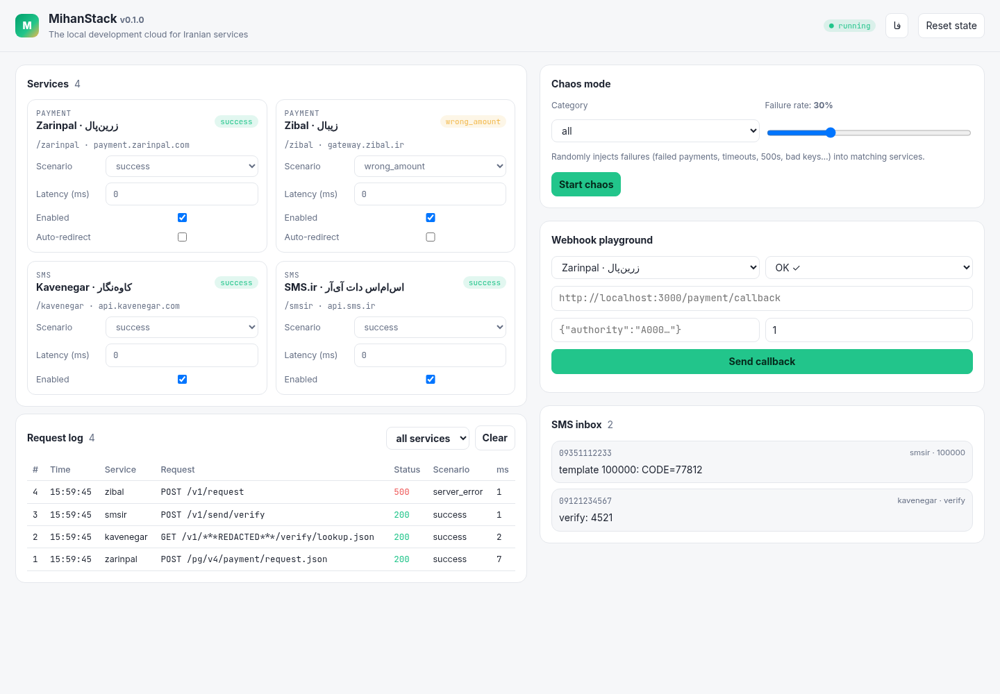
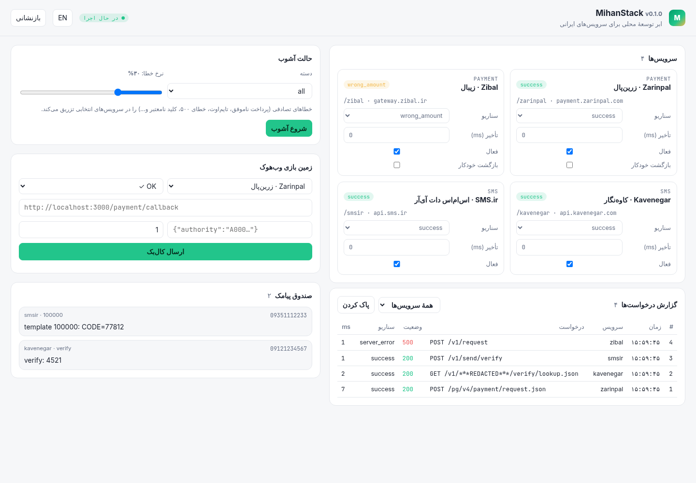

<div align="center">

# MihanStack · میهن‌استک

**The local development cloud for Iranian services**

Emulate **Zarinpal**, **Zibal**, **Kavenegar** and **SMS.ir** on your machine, so you can build and test
payments and SMS without real money, real API keys or an internet connection.

[](https://github.com/mrzroot/mihanstack/actions/workflows/ci.yml)
[](LICENSE)

[](https://github.com/mrzroot/mihanstack/releases)
[](https://github.com/mrzroot/mihanstack/stargazers)

[**Website**](https://mrzroot.github.io/mihanstack/) · [English](#english) · [فارسی](#فارسی) · [Changelog](CHANGELOG.md) · [Contributing](CONTRIBUTING.md)



</div>

### ⚡ Quickstart

```bash
npx github:mrzroot/mihanstack     # emulator + dashboard on http://localhost:8585
```

Then point your app at `http://localhost:8585/zarinpal` instead of `https://payment.zarinpal.com` (Zibal, Kavenegar and SMS.ir work the same way, [table below](#quick-start)).

---

## English

### Why

Testing an Iranian payment or SMS integration usually means a real merchant ID, real API credit, a sandbox
that is sometimes down, and no easy way to reproduce "the bank called my callback twice" or "verify came back
with a different amount". **MihanStack** is to Iranian APIs what LocalStack is to AWS: one local process
that speaks the same request/response formats and error codes, with switchable failure scenarios.

### Quick start

```bash
# Run without installing (Node 18.17+)
npx github:mrzroot/mihanstack            # → http://localhost:8585

# or with Docker (build locally; see "Status" below)
docker build -t mihanstack https://github.com/mrzroot/mihanstack.git
docker run --rm -p 8585:8585 mihanstack
```

Then point your app at MihanStack instead of the real host:

| Service | Real base URL | MihanStack base URL |
|---------|---------------|---------------------|
| Zarinpal v4 | `https://payment.zarinpal.com` | `http://localhost:8585/zarinpal` |
| Zibal | `https://gateway.zibal.ir` | `http://localhost:8585/zibal` |
| Kavenegar | `https://api.kavenegar.com` | `http://localhost:8585/kavenegar` |
| SMS.ir | `https://api.sms.ir` | `http://localhost:8585/smsir` |

Unprefixed paths work too when they are unambiguous, and requests whose `Host` header is the real hostname
(for example via `/etc/hosts` or a reverse proxy) are routed to the right emulator.

```bash
# 1. Create a Zarinpal payment
curl -s localhost:8585/zarinpal/pg/v4/payment/request.json -H 'content-type: application/json' -d '{
  "merchant_id": "1344b5d4-0048-11e8-94db-005056a205be",
  "amount": 10000, "callback_url": "http://localhost:3000/verify", "description": "order 42"}'
# → {"data":{"code":100,"message":"Success","authority":"A0f3…","fee_type":"Merchant","fee":100},"errors":[]}

# 2. Open the fake bank page (Persian, RTL), click pay → redirected to your callback with ?Authority=…&Status=OK
open http://localhost:8585/zarinpal/pg/StartPay/A0f3…

# 3. Verify
curl -s localhost:8585/zarinpal/pg/v4/payment/verify.json -H 'content-type: application/json' \
  -d '{"merchant_id":"1344b5d4-0048-11e8-94db-005056a205be","amount":10000,"authority":"A0f3…"}'
# → {"data":{"code":100,"message":"Paid","ref_id":201834521,"card_pan":"502229******5995",…},"errors":[]}

# Send an OTP through Kavenegar and read it back (great for e2e tests)
curl -s "localhost:8585/kavenegar/v1/ANYKEY/verify/lookup.json?receptor=09121234567&token=4521&template=verify"
curl -s "localhost:8585/_mihan/sms?receptor=09121234567&last=1"
```

### What's emulated

| Provider | Endpoints | Notable behaviour |
|----------|-----------|-------------------|
| **Zarinpal** v4 | `POST /pg/v4/payment/request.json`, `GET /pg/StartPay/{authority}`, `POST /pg/v4/payment/verify.json`, `POST /pg/v4/payment/inquiry.json` | `{data, errors}` envelope; codes `100`, `101` (already verified), `-9` with field validations, `-10`, `-11`, `-50` (amount mismatch), `-51`, `-53`, `-54` |
| **Zibal** | `POST /v1/request`, `GET /start/{trackId}`, `POST /v1/verify`, `POST /v1/inquiry` | `result` codes `100`, `102`, `103`, `105`, `106`, `113`, `201`, `202`, `203`; callback `success/trackId/orderId/status` |
| **Kavenegar** | `/v1/{API-KEY}/sms/send.json`, `/verify/lookup.json`, `/sms/status.json`, `/account/info.json` (GET or POST form) | `{return:{status,message}, entries}`; HTTP status = `return.status` (`403`, `411`, `418`, `424`, …); templates with `%token%` |
| **SMS.ir** v1 | `POST /v1/send/bulk`, `/v1/send/likeToLike`, `/v1/send/verify`, `GET /v1/credit`, `/v1/line` | `X-API-KEY` header; `{status, message, data}`; status `1` ok, `10`, `13`, `101`, `102`, `104`, `107`, `113`, … |

Formats follow the providers' public documentation as closely as it allows; rarely-documented error codes
are marked approximate in the source. Found a mismatch with the real API? Please open an issue.

### Scenarios

Set per service in `mihanstack.yml`, from the dashboard, with `--scenario svc=name`, through the admin API,
or per request with the `X-Mihan-Scenario` header (or `?mihan_scenario=`).

| Scenario | Payments | SMS |
|----------|----------|-----|
| `success` | normal flow | message accepted and stored in the inbox |
| `failed` | user cancels / bank declines → `Status=NOK`, verify fails | insufficient credit (`418` / `102`) |
| `duplicate_callback` | your callback is hit twice (redirect + server-side resend) | – |
| `wrong_amount` | Zarinpal verify → `-50`; Zibal verify returns a different `amount` | – |
| `invalid_signature` | merchant/terminal invalid (`-10` / `102`) | invalid API key (`403` / `10`) |
| `merchant_disabled` | terminal inactive (`-11` / `103`) | account disabled (`401` / `13`) |
| `timeout` | connection held for `timeoutMs`, then dropped | same |
| `network_error` | TCP connection reset | same |
| `server_error` | HTTP 500 HTML page | same |
| `latency` | adds `slowMs` (default 3 s) | same |

Every service also has a `latency` setting (`250` or a range like `"100-800"`).

```yaml
# mihanstack.yml   (create one with: npx github:mrzroot/mihanstack init)
port: 8585
services:
  zarinpal:
    scenario: duplicate_callback
    latency: "100-400"
    autoRedirect: true          # StartPay redirects immediately: no click needed in CI
  zibal: wrong_amount           # shorthand
  kavenegar:
    options:
      apiKeys: [MY-TEST-KEY]    # only these keys are accepted (empty = any)
      templates: { verify: "کد تایید شما: %token%" }
chaos: { enabled: false, category: payment, rate: 0.2 }
plugins: [./plugins/idpay.mjs]
```

### Chaos mode

```bash
npx github:mrzroot/mihanstack chaos payment --rate 0.3   # starts MihanStack with chaos, or
                                                          # switches it on in a running instance
npx github:mrzroot/mihanstack chaos network --seed 42    # only timeouts/resets/500s/latency, reproducible
npx github:mrzroot/mihanstack chaos payment --off
```

Categories: `all`, `payment`, `sms`, `network`, or a single service name. Chaos-hit requests are flagged in the log.

### Webhook playground

Fire a realistic provider callback at your own app and see the status and response time, from the
dashboard or the CLI:

```bash
npx github:mrzroot/mihanstack webhook zarinpal --url http://localhost:3000/verify -P authority=A0f3… --status ok --repeat 2
#   GET http://localhost:3000/verify?Authority=A0f3…&Status=OK
#   #1  200    38 ms  Thanks for your payment
#   #2  409     4 ms  already processed        ← your duplicate protection works
```

### Record & replay

Record real sandbox traffic once (secrets are redacted: merchant IDs, API keys in URLs and headers,
card numbers; mobile numbers are masked), then replay it offline forever:

```bash
npx github:mrzroot/mihanstack record --upstream zarinpal=https://sandbox.zarinpal.com --out fixtures
npx github:mrzroot/mihanstack replay fixtures --strict     # 404 for anything not recorded
```

### Plugins

```js
// plugins/idpay.mjs (a plain object works; defineProvider adds validation and types)
import { defineProvider } from "mihanstack";

export default defineProvider({
  name: "idpay",
  category: "payment",
  scenarios: ["success", "failed"],
  endpoints: [
    { method: "POST", path: "/v1.1/payment", handler: (ctx) =>
        ctx.scenario === "failed" ? { status: 406, body: { error_code: 32 } }
                                  : { status: 201, body: { id: ctx.randomId(12) } } },
  ],
});
```

Handlers get `ctx.req` (method, path, query, headers, body, params), `ctx.scenario`, `ctx.settings`,
persistent `ctx.state`, `ctx.sms()` for the inbox and `ctx.fireCallback()`. Timeouts, resets, 500s and
latency come for free. A complete example is in [`examples/plugins/idpay.mjs`](examples/plugins/idpay.mjs).

### Dashboard

`http://localhost:8585` shows every service with its scenario and latency switches, the live request log
(click a row for redacted request/response), chaos controls, the webhook playground and the SMS inbox.
It works fully offline (no CDN, no web fonts) and switches between English and Persian with proper RTL.

### Use in CI (GitHub Actions)

```yaml
- uses: mrzroot/mihanstack@v0.1.1
  id: mihan
  with:
    scenarios: |
      zarinpal=success
      kavenegar=failed
- run: npm test
  env:
    ZARINPAL_BASE_URL: ${{ steps.mihan.outputs.url }}/zarinpal
```

Inputs: `port`, `config`, `scenarios`, `chaos`, `chaos-rate`, `auto-redirect` (default `true`), `replay`,
`node-version`. Outputs: `url`, `log`; `MIHANSTACK_URL` is also exported to later steps.

### Admin API

| Route | Purpose |
|-------|---------|
| `GET /_mihan/health` | liveness + service list |
| `GET /_mihan/services` · `PUT /_mihan/services/{name}` | read / change scenario, latency, enabled, options |
| `GET /_mihan/logs?since=&service=` · `DELETE` | request log (redacted) |
| `GET /_mihan/sms?receptor=&last=1` · `DELETE` | SMS inbox (read OTPs in tests) |
| `GET /_mihan/transactions` | payment state per provider |
| `GET/POST/DELETE /_mihan/chaos` | chaos settings |
| `POST /_mihan/webhook` | webhook playground |
| `POST /_mihan/reset` | clear state, logs and inbox |

### CLI

```
mihanstack [start]   --port --host --config --scenario svc=name --latency svc=ms --auto-redirect
                     --chaos <category> --rate --seed --replay <dir> --strict
mihanstack init      write a sample mihanstack.yml
mihanstack services  list services, endpoints, scenarios (--json)
mihanstack chaos     <category> [--rate] [--seed] [--off] [--url]
mihanstack webhook   <provider> --url … [--status ok|nok] [-P k=v] [--repeat n]
mihanstack record    --upstream svc=url [--out fixtures]
mihanstack replay    [dir] [--strict]
mihanstack inbox     [--receptor] [--last]
```

### Status

v0.1.1. **Not published to npm or Docker Hub yet**: use `npx github:mrzroot/mihanstack` (builds on install)
or build the Docker image yourself. The provider emulations are based on public documentation and have not
been checked byte-for-byte against live production responses.

### Development

```bash
npm ci        # also builds dist/
npm test      # vitest: providers, scenarios, chaos, webhooks, record/replay, plugins, CLI
npm run typecheck
```

---

<div dir="rtl" align="right">

## فارسی

### میهن‌استک چیست؟

**ابر توسعهٔ محلی برای سرویس‌های ایرانی.** میهن‌استک درگاه‌های پرداخت **زرین‌پال** و **زیبال** و سرویس‌های پیامکی
**کاوه‌نگار** و **SMS.ir** را روی سیستم خودتان شبیه‌سازی می‌کند تا بدون پول واقعی، بدون کلید API واقعی و حتی بدون
اینترنت، پرداخت و پیامک را توسعه دهید و تست کنید. همان کاری که LocalStack برای AWS می‌کند، برای APIهای ایرانی.

### شروع سریع

</div>

```bash
npx github:mrzroot/mihanstack          # داشبورد: http://localhost:8585
docker build -t mihanstack https://github.com/mrzroot/mihanstack.git && docker run --rm -p 8585:8585 mihanstack
```

<div dir="rtl" align="right">

کافی است آدرس پایهٔ سرویس را در برنامه‌تان عوض کنید؛ مثلاً به‌جای `https://payment.zarinpal.com` از
`http://localhost:8585/zarinpal` استفاده کنید. قالب درخواست و پاسخ و کدهای خطا تا جایی که مستندات عمومی اجازه می‌دهد
مثل سرویس واقعی است.

### سناریوها

هر سرویس یک سناریو دارد که از فایل `mihanstack.yml`، داشبورد، خط فرمان (`--scenario zarinpal=wrong_amount`) یا برای
یک درخواست خاص با هدر `X-Mihan-Scenario` تعیین می‌شود:

- `success`: مسیر عادی
- `failed`: انصراف کاربر یا رد بانک؛ در پیامک، اعتبار ناکافی
- `duplicate_callback`: کال‌بک شما دو بار صدا زده می‌شود
- `wrong_amount`: مبلغ تایید با مبلغ سفارش یکی نیست
- `invalid_signature`: مرچنت یا کلید API نامعتبر
- `merchant_disabled`: درگاه یا حساب غیرفعال
- `timeout`، `network_error`، `server_error` و `latency`: تایم‌اوت، قطع اتصال، خطای ۵۰۰ و کندی

### حالت آشوب

</div>

```bash
npx github:mrzroot/mihanstack chaos payment --rate 0.3
```

<div dir="rtl" align="right">

به‌صورت تصادفی خطا تزریق می‌کند تا مطمئن شوید برنامه‌تان در برابر رفتار ناپایدار بانک و اپراتور مقاوم است.
دسته‌ها: `all`، `payment`، `sms`، `network` یا نام یک سرویس.

### زمین بازی وب‌هوک

یک کال‌بک واقعی‌نما (مثلاً `?Authority=…&Status=OK` زرین‌پال) را به آدرس برنامهٔ خودتان بفرستید و کد وضعیت و زمان
پاسخ را ببینید؛ از داشبورد یا با فرمان `mihanstack webhook`.

### ضبط و پخش

ترافیک واقعی sandbox را یک بار ضبط کنید (شناسهٔ مرچنت، کلیدهای API و شماره کارت حذف و شماره موبایل‌ها پوشانده
می‌شوند) و بعد بدون اینترنت بازپخش کنید: `mihanstack record` و `mihanstack replay`.

### افزونه‌ها

با `defineProvider({ name, endpoints, scenarios })` هر سرویس دیگری (مثلاً IDPay یا یک درگاه بانکی) را در چند خط
اضافه کنید. نمونه: `examples/plugins/idpay.mjs`.

### داشبورد

داشبورد `localhost:8585` سرویس‌ها، انتخاب سناریو و تأخیر، گزارش زندهٔ درخواست‌ها، کنترل آشوب، زمین بازی وب‌هوک و
صندوق پیامک (همراه کدهای تایید) را نشان می‌دهد. کاملاً آفلاین کار می‌کند و با یک کلیک بین فارسی (راست‌به‌چپ) و
انگلیسی جابه‌جا می‌شود.

</div>

<div align="center"></div>

<div dir="rtl" align="right">

### استفاده در CI

اکشن `mrzroot/mihanstack@v0.1.1` را در گردش‌کار گیت‌هاب اضافه کنید تا پیش از اجرای تست‌ها، میهن‌استک بالا بیاید.
نمونه در `examples/ci-usage.yml`.

### وضعیت

نسخهٔ ۰٫۱٫۰. هنوز روی npm و Docker Hub منتشر نشده است؛ از `npx github:mrzroot/mihanstack` استفاده کنید یا ایمیج
داکر را خودتان بسازید. شبیه‌سازی‌ها بر اساس مستندات عمومی است و با پاسخ‌های واقعی محیط عملیاتی بایت‌به‌بایت مقایسه
نشده است. اگر تفاوتی دیدید، لطفاً issue باز کنید.

</div>

---

## License · مجوز

[MIT](LICENSE) © mrzroot. Not affiliated with Zarinpal, Zibal, Kavenegar or SMS.ir; names are used only to
describe API compatibility.
